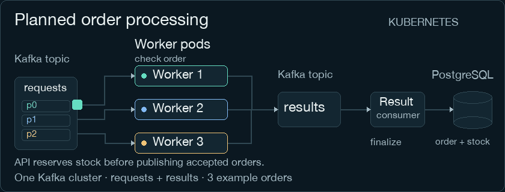
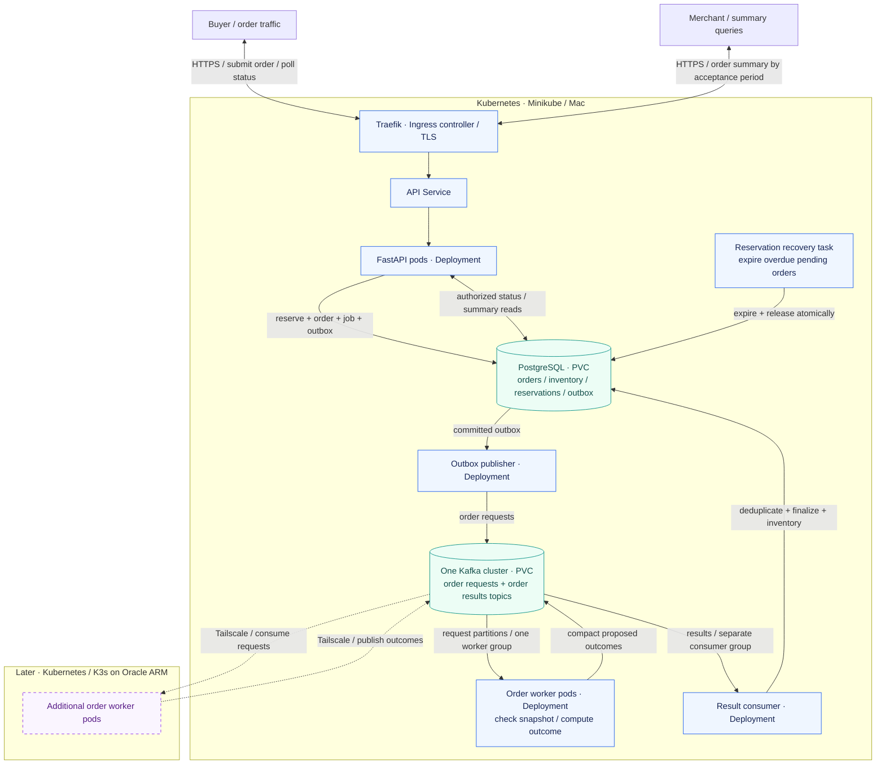

# LabFlow

**Orders. Finite inventory. Observable operations.**

[](https://github.com/thiagogenez/labflow/actions/workflows/ci.yml)
[](pyproject.toml)
[](tests/)
[](pyproject.toml)
[](pyproject.toml)
[](LICENSE)

[Quick start](#-quick-start) · [How it works](#-how-it-works) · [Application model](src/labflow/README.md) · [Quality](#-quality-and-ci) · [Roadmap](#-roadmap) · [Development](docs/development.md)

LabFlow is a public Platform Engineering and SRE lab building an observable order-processing system: buyers place orders against finite inventory, and merchants query confirmed and pending order values. Reproducible API traffic and controlled failures will support operational experiments.

**Running today:** a bounded Python generator, report aggregator, shared product catalogs, store-specific EUR/BRL price lists and quotations, immutable inventory snapshots and accepted-order processing lifecycle rules. Lifecycle rules are verified locally; their remote CI is pending. **Next:** order-linked reservations, atomic persistence, asynchronous order processing and merchant summaries. The [agreed application contract](docs/application-contract.md) defines this target; the order flow is not implemented yet.



*Planned processing after the API reserves stock and commits the order and outbox. Requests and results are topics in one Kafka cluster; three colors identify distinct orders, not repeated copies. Motion is an illustration, not measured performance. [Static diagram](docs/assets/labflow-flow.png).*

## 🧪 Current capabilities

| Capability | State | Evidence |
| --- | --- | --- |
| Deterministic sales generation | Implemented | Seeded generation, bounded inputs and isolated random state |
| Report aggregation | Implemented | Counts, units and revenue in integer cents; empty-input behavior |
| Unit tests | 223 cases passed locally | Includes 30 inventory snapshot and 63 lifecycle cases; the lifecycle slice awaits its own PR CI |
| Python quality checks | Passed locally and in ARM64 CI | Ruff, Black and Pylint |
| CI and security jobs | Shared gate verified on ARM64 | Python/ShellCheck checks, Gitleaks and OSV-Scanner passed on PR #2 and `main` |
| Catalogs and quotations | Implemented | Shared product metadata, independent store price lists and versioned EUR/BRL quotations |
| Inventory read snapshots | Implemented | Validated immutable counts and derived availability per store/SKU; no persistence or concurrency control |
| Order processing lifecycle | Verified locally; remote CI pending | Frozen accepted quote, UTC timestamps, safe reasons and guarded terminal proposals; no persistence |
| Order admission, inventory and merchant summaries | Contract agreed; implementation pending | Atomic reservations, asynchronous processing, expiry and idempotent finalization |
| API, Kafka and PostgreSQL | Planned | Order admission, transactional outbox, event processing and authorized reads |
| Kubernetes and observability | Planned | Helm, Kustomize, Traefik, Prometheus, Grafana and Alertmanager |
| GitOps and remote capacity | Later milestones | Argo CD, GHCR and Oracle-hosted workers |

The shared quality gate passed [PR CI](https://github.com/thiagogenez/labflow/actions/runs/42521136229) and [main CI](https://github.com/thiagogenez/labflow/actions/runs/42521372612) at `2ff07d8`. Later changes require their own checks; the live badge tracks the current `main` workflow.

## ⚡ Quick start

**Prerequisites:** Git, Make, CPython 3.14.10 and uv on macOS or Linux. The implemented core runs directly in a Python environment; Docker and Kubernetes enter in later milestones.

```bash
git clone https://github.com/thiagogenez/labflow.git
cd labflow
make setup
```

Exercise the existing calculation foundation using the project environment. This example generates synthetic sale rows; it does not place orders or modify stock:

```bash
.venv/bin/python - <<'PY'
from labflow.reporting import summarize_sales
from labflow.synthetic import generate_sales

sales = generate_sales(seed=42, rows=3)
report = summarize_sales(sales)
print(report)
PY
```

Expected output:

```text
{'sales_count': 3, 'units_sold': 8, 'revenue_cents': 16998}
```

`make setup` installs the pinned development environment, downloads a checksum-verified ShellCheck binary into `.venv/bin` and activates the shared commit checks for that clone.

Run the test suite from the repository root:

```bash
.venv/bin/python -m pytest -v
```

### Calculation contract

- `generate_sales` accepts **1–10,000 rows** and an integer seed from **0 through 4,294,967,295**. Booleans, other types and out-of-range inputs are rejected.
- Each call has its own random generator. Retain the seed, row count, generator version (`sales-v1`) and Python version when recording an experiment.
- `summarize_sales` receives sale records and returns `sales_count`, `units_sold` and `revenue_cents`. Empty input returns three zeros.
- Prices and revenue use integer cents. The input limit bounds one generation call; aggregate concurrency and job-cost controls are planned separately.

## ⚙️ How it works

### Today: the reporting core

1. **Generate:** [`generate_sales`](src/labflow/synthetic.py) validates the seed and row limit, then creates the same sales for the same versioned inputs.
2. **Calculate:** each sale exposes `total_cents = quantity × unit_price_cents`. [`summarize_sales`](src/labflow/reporting.py) counts sales, adds units and sums those totals.
3. **Return:** the caller receives a dictionary containing three integers. There is no API, queue or database in this execution path yet.

The quick start exercises the existing calculation foundation directly. Sale rows are not order entities. The new order path will use catalog prices and accepted order snapshots; workers will not generate purchases. Reproducibility seeds belong to the traffic generator, outside buyer and merchant interfaces.

### Target: reserved stock and asynchronous orders

**Planned architecture.** Kubernetes will run the application core in **Minikube on the Mac**. A separate **K3s cluster on an Oracle ARM VM** will add workers later. These services and clusters are not implemented yet.



1. **Accept and reserve.** The API will resolve prices from the selected store's price list and reserve all order items in the same transaction as the order, processing job and outbox event. It returns `202 Accepted` only after commit. Insufficient stock rejects admission without partial reservations. Replaying an accepted idempotency key returns the existing order without reserving again.
2. **Process asynchronously.** The outbox publisher sends accepted snapshots to Kafka. Local and future Oracle workers share one request consumer group, check the order and publish compact proposed outcomes before committing input offsets. The animation illustrates three orders/partitions; the first deployment starts with one worker.
3. **Finalize atomically.** The result consumer updates the official state and resolves the reservation in PostgreSQL before committing result offsets. Confirmation keeps stock committed for later fulfillment without reducing physical units; rejection or definitive technical failure releases the pending hold. Repeated computation/delivery must not repeat these effects.
4. **Recover abandoned reservations.** A core recovery task expires overdue pending orders and releases their reservations; confirmed commitments are excluded. Expiry and completion compete through guarded transactions; late outcomes cannot confirm released stock. Deadlines and recovery cadence will be selected and tested during implementation.
5. **Query existing orders.** Buyers poll their own order state. Authorized merchants receive a bounded summary in the same HTTP request, reading PostgreSQL. The period uses server-assigned acceptance time, with an inclusive start and exclusive end. Heavy reports and exports can become asynchronous later.

| Order state | Meaning | Inventory effect |
| --- | --- | --- |
| `pending` | Durably accepted; processing or bounded recovery pending | Stock reserved |
| `confirmed` | Processing completed; payment and fulfillment remain separate | Stock remains committed until shipment |
| `rejected` | Business rejection after admission | Reservation released |
| `processing_failed` | Definitive technical failure or reservation deadline exceeded | Reservation released |

**Merchant values are not payments received.** Show confirmed and pending amounts/counts separately, plus their combined amount; rejected and technically failed orders are excluded from that amount. Confirmation moves value between buckets without adding it again. A past period reflects current order states when queried again. Stock-replenishment endpoints and payments are later extensions.

**Example:** with ten pieces and three concurrent requests for five, two can reserve successfully and one is refused at admission, absent intervening stock changes. Restarting services must not replenish initial inventory. See the [full contract](docs/application-contract.md) for proposed interfaces, inventory invariants, failure windows and acceptance tests.

Oracle workers will have no direct database access. Tailscale will connect the environments privately; Kafka, PostgreSQL and administrative interfaces will not be exposed directly to the internet. One Mac remains one physical failure domain.

### Kubernetes operation

| Responsibility | Planned resources and behavior |
| --- | --- |
| HTTP routing | An Ingress defines routing and TLS configuration. Traefik is its controller; the API Service selects ready FastAPI pods. |
| Application lifecycle | Deployments manage API, publisher, worker and result-consumer pods; the core also runs reservation recovery, with health probes, resource requests and limits. |
| Persistent data | PostgreSQL and Kafka use PersistentVolumeClaims (PVCs). Provisioner behavior must be checked before multinode experiments; local volumes do not provide independent-host recovery. |
| Isolation | Namespaces, ResourceQuota, LimitRange, ServiceAccounts/RBAC and NetworkPolicies enforced by the selected CNI. |
| Worker autoscaling | Metrics Server → resource metrics API → CPU HPA → worker Deployment replica count. CPU requests define the utilization baseline. |

HTTP load balancing distributes requests across API pods; Kafka distributes partitions across consumers. HPA adds worker pods within available cluster capacity. More pods do not add physical CPU or memory, and useful consumer parallelism depends on the partition count. Oracle capacity is activated separately and manually at first. See [Kubernetes CPU autoscaling](https://kubernetes.io/docs/concepts/workloads/autoscaling/horizontal-pod-autoscale/) for the metrics path.

### Reliability by design

These are implementation and experiment requirements for the distributed milestones:

| Concern | Intended mechanism | Required verification |
| --- | --- | --- |
| Order admission | Reserve all items and record order/job/outbox in one transaction | Concurrent last-unit requests, multi-item rollback and HTTP retries |
| Duplicate delivery | At-least-once processing with transactional result deduplication | Redeliver a result after a database commit and verify unchanged order counts, stock and summary values |
| Retries | Durable logical attempts, bounded retries, backoff and jitter | Redelivery versus a new attempt, exhaustion and stale outcomes |
| Reservation recovery | Durable deadlines and guarded expiry/confirmation | Release after failure, expiry races and late-result suppression |
| Scaling | CPU-based HPA with Metrics Server and sufficient Kafka partitions | Observe additional available workers receiving work under controlled load |
| Resource sharing | Requests, limits, quotas and admission bounds | Measure pressure, backlog and competing workloads |
| Recovery | Off-Mac backups, restore procedures and fencing | Measure data loss, duplicate effects, RPO and RTO |

The initial deployment has a single physical host. High availability, provider-loss recovery and performance improvements remain experiment outcomes to establish.

### Observability and delivery

Planned observability follows a clear path: application and infrastructure metrics → **Prometheus** → **Grafana dashboards** and **Alertmanager notifications**. Experiments will correlate CPU, memory, restarts, queue lag, throughput, order-completion latency, reserved/available stock and reservation age. Order/job identifiers belong in logs; metric labels remain bounded.

**Helm** will manage infrastructure components. **Kustomize** will define application bases and local/autoscaling overlays. **Argo CD** and digest-based image promotion through **GHCR** enter in the GitOps milestone. Initial HPA scaling uses Metrics Server; Prometheus provides operational visibility.

## 🛠 Quality and CI

The [CI workflow](.github/workflows/ci.yml) defines three independent jobs:

| Job | Checks |
| --- | --- |
| Python quality and tests | Hashed development environment, package/dependency consistency and native ARM64 checks, then the same pre-commit ShellCheck/Ruff/Black/Pylint/pytest gates used locally against every versioned Python file |
| Secret scan | Full-history Gitleaks scanning with redacted findings |
| Dependency audit | OSV-Scanner audit of pinned Python dependencies |

Jobs have read-only repository permissions and explicit timeouts. Actions are pinned to full commit references; scanner downloads have fixed versions and SHA-256 checksums. PR runs can cancel obsolete runs. Publishing and deployment credentials are outside this CI scope.

Every commit automatically runs `make check` against all indexed Python and shell files and the full test suite, temporarily preserving unstaged tracked changes. This includes documentation and CI scripts. CI runs the same gate against its clean checkout. Scanner installation logic lives in [`.github/scripts/`](.github/scripts/). The protected main branch requires pull requests, signed commits and all three CI checks. See [development and validation](docs/development.md) for local checks and the limits of each result.

## 🗺 Roadmap

- [x] Bounded, reproducible reporting core and unit tests.
- [x] Local quality tooling and CI definitions.
- [x] Complete successful foundation PR and `main` CI runs.
- [x] Agree the buyer, finite-inventory and merchant-summary contract.
- [ ] Implement typed orders and catalog/initial-stock fixtures.
- [ ] Add API admission, atomic reservations and authorized summaries.
- [ ] Add outbox, Kafka, workers, finalization and reservation recovery.
- [ ] Run on local Kubernetes with Helm and Kustomize.
- [ ] Establish observability and reproduce the duplicate-delivery failure window.
- [ ] Measure fixed-worker versus CPU-autoscaling behavior.
- [ ] Add GitOps delivery, rollback and image promotion.
- [ ] Extend worker capacity to Oracle and verify backup/restore procedures.
- [ ] Explore Redis caching, replicated profiles and network-partition behavior.

Each milestone requires execution evidence and an explanation of observed behavior. The [implementation plan](docs/plan.md) defines the acceptance criteria; configuration files alone do not complete an operational milestone.

## Repository map

```text
.github/
  workflows/ci.yml             CI jobs and permissions
  scripts/                     Scanner installers and README asset generation
docs/
  assets/                      Animated and static flow illustrations
  application-contract.md      Orders, reservations, states and summary semantics
  development.md               Local setup, checks and contribution workflow
  plan.md                      Architecture, milestones and experiments
  preflight.md                 Environment observations and capacity assumptions
  compatibility.md             Tool versions and validation history
Makefile                       Developer setup and quality commands
.pre-commit-config.yaml         Shared commit and CI checks
src/labflow/
  README.md                    Class relationships and animated pricing example
  currency.py                  Explicit supported currency codes
  store.py                     Store identity and its fixed currency
  catalog.py                   Shared product metadata snapshots
  price_list.py                Store-specific prices and offered SKUs
  orders.py                    Quotations and accepted-order processing lifecycle
  inventory.py                 Immutable inventory read snapshots and derived availability
  validation.py                Shared integer validation and UTC normalization
  synthetic.py                 Deterministic sale records
  reporting.py                 Compact report aggregation
tests/                         Unit and parametrized input tests
```

## 🤝 Contributing

Keep changes focused, include relevant tests and run the checks in [the development guide](docs/development.md). Document behavior changes and operational assumptions. Use fictitious data and configuration placeholders; keep credentials and employer material outside the repository. Contributor and agent conventions are in [AGENTS.md](AGENTS.md).

## License

Licensed under the [MIT License](LICENSE).

Copyright © 2026 Thiago Augusto Lopes Genez.
