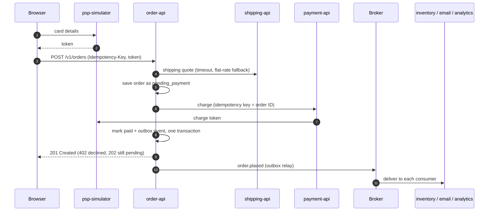

# LabFlow

An event-driven order-processing system: a small shop with checkout, payments, shipping quotes, refunds, stock, email and analytics. Services in Go and Python exchange events through one message broker per deployment, chosen with `BROKER=rabbitmq|kafka|sqs`.

LabFlow is the application half of a public Platform Engineering and SRE learning lab. Its job is to produce realistic traffic, data and failures for the platform in [labflow-platform](https://github.com/thiagogenez/labflow-platform), where the plan, design decisions and runbooks live. It serves no real customers. The payment provider, the supplier and the mail server are simulations.

## Status

Implementation starts on 2026-11-20. This table is the source of truth for what exists.

| Capability | Status |
| --- | --- |
| Quality gate (pre-commit hooks, commit-message checks, CI) | Running in CI |
| Contribution workflow (pull request template, ticket references, pull request check) | Configured, CI pending first run |
| Event contracts (CloudEvents JSON Schema) | `order.placed` validated by the hooks; the others land with their producers |
| Services and Docker Compose environment | Planned |
| Message broker adapters (RabbitMQ, Kafka, SNS + SQS) | Planned |
| Signed multi-arch images on GHCR | Planned |

## Services

Planned services:

| Service | Language | Role |
| --- | --- | --- |
| `storefront` | Static HTML and JavaScript | Shop UI without login: catalog, cart, checkout, order status, refunds |
| `order-api` | Go | Catalog, server-side cart, checkout, orders and refund requests; transactional outbox |
| `payment-api` | Go | Charges and refunds through the payment provider; receives its signed webhooks |
| `shipping-api` | Python | Shipping quotes by weight, destination zone and speed |
| `inventory` | Go | Stock allocation and backorders; goods receipts and automatic replenishment |
| `email-worker` | Python | Order confirmation, backorder and refund emails |
| `analytics-worker` | Python | Revenue per minute and top products, net of VAT and refunds |
| `psp-simulator` | Go | Simulated external payment provider, treated as a black box |
| `supplier-simulator` | Go | Simulated external supplier: accepts purchase orders and delivers stock after a lead time |

## Order Flow

Target design, not yet implemented:

A reconciler resends the same idempotent charge for orders left in `pending_payment`: the order becomes paid when the charge succeeds, or `payment_failed` when it is declined or still unresolved after 15 minutes. A charge that succeeds after that is refunded automatically and the customer is told by email.

## Events

Events are [CloudEvents](https://cloudevents.io/) whose JSON Schema contracts live in [`contracts/events/`](contracts/events/). On Kafka, each producer writes to its own topic (`orders`, `payments`, `inventory`) keyed by order ID; on RabbitMQ, the routing key is the event type. Delivery is at least once and unordered, so every consumer is idempotent and tolerates reordering.

| Event type | Producer | Consumers |
| --- | --- | --- |
| `labflow.order.placed.v1` | `order-api` | `inventory`, `email-worker`, `analytics-worker` |
| `labflow.refund.requested.v1` | `order-api` | `payment-api` |
| `labflow.payment.refunded.v1` | `payment-api` | `order-api` |
| `labflow.payment.refund_failed.v1` | `payment-api` | `order-api` |
| `labflow.refund.completed.v1` | `order-api` | `inventory`, `email-worker`, `analytics-worker` |
| `labflow.inventory.allocated.v1` | `inventory` | `order-api`, `email-worker` |
| `labflow.inventory.backorder_allocated.v1` | `inventory` | `order-api`, `email-worker` |

## Production Gaps

LabFlow is designed to production standards; only its data and its external systems are simulated. A real shop would also need the following, which the lab deliberately leaves out:

- VAT through the One-Stop Shop, and invoices. Charging German VAT on every EU sale is valid only below the EUR 10,000 yearly threshold for EU distance sales.
- Erasure and retention of personal data under the GDPR.
- Fulfilment (picking, shipping, tracking) and returns logistics. Refunds assume the goods come back resellable.
- An authenticated back office for the catalogue, prices and stock.
- Customer accounts, 3-D Secure and chargebacks.

## License

[MIT](LICENSE)
