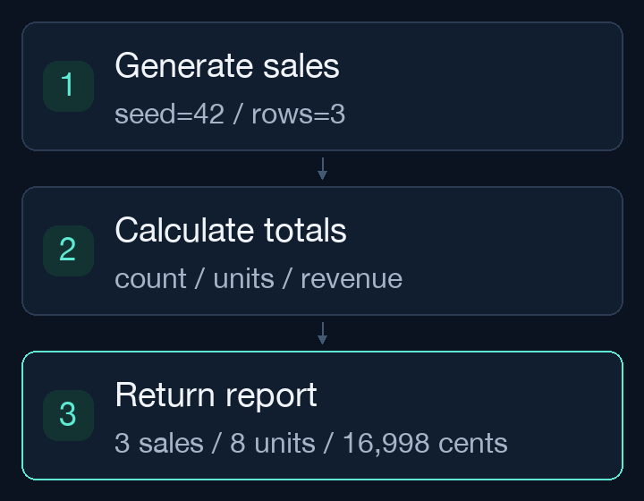
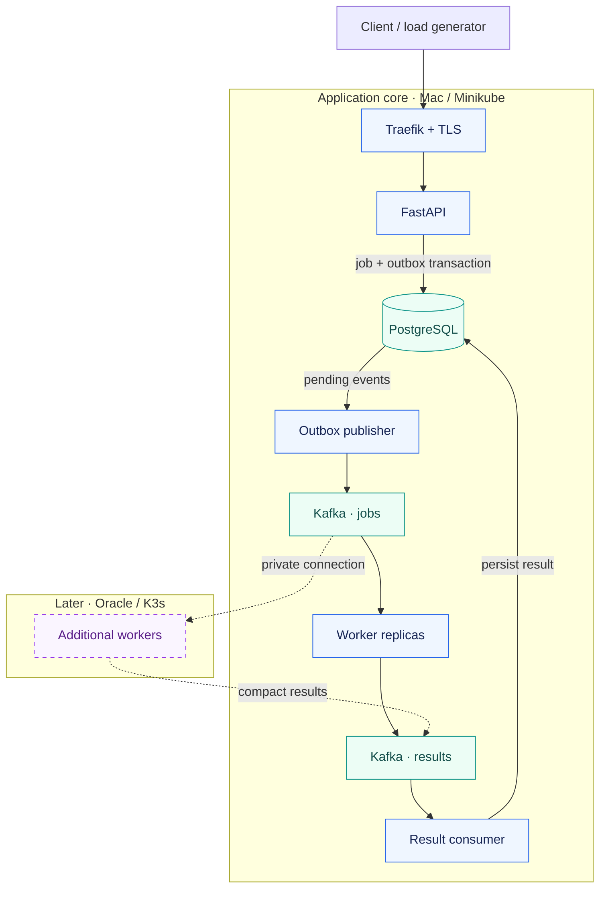

# LabFlow

**Reproducible workloads. Compact results. Observable operations.**

[](https://github.com/thiagogenez/labflow/actions/workflows/ci.yml)
[](pyproject.toml)
[](tests/)
[](pyproject.toml)
[](pyproject.toml)
[](LICENSE)

[Quick start](#-quick-start) · [System design](#-system-design) · [Quality](#quality-and-ci) · [Roadmap](#-roadmap) · [Development](docs/development.md)

LabFlow is a job-processing platform under development, built around reproducible reporting workloads. Its current Python core generates bounded synthetic sales and aggregates them into compact reports. The target platform adds asynchronous execution, durable job state, Kubernetes operations and measurable recovery behavior.

The project is developed publicly as a platform engineering and SRE lab, with product-oriented code, explicit contracts and reproducible experiments.



*Illustration of the implemented Python calculation, not a live execution trace. [View animation](docs/assets/labflow-flow.gif).*

## Current capabilities

| Capability | State | Evidence |
| --- | --- | --- |
| Deterministic sales generation | Implemented | Seeded generation, bounded inputs and isolated random state |
| Report aggregation | Implemented | Counts, units and revenue in integer cents; empty-input behavior |
| Unit tests | Passed locally and in ARM64 CI | 26 pytest cases across 14 functions |
| Python quality checks | Passed locally and in ARM64 CI | Ruff, Black and Pylint |
| CI and security jobs | Shared gate verified on ARM64 | Python/ShellCheck checks, Gitleaks and OSV-Scanner passed on PR #2 and `main` |
| API, Kafka and PostgreSQL | Planned | Job lifecycle, transactional outbox and result persistence |
| Kubernetes and observability | Planned | Helm, Kustomize, Traefik, Prometheus, Grafana and Alertmanager |
| GitOps and remote capacity | Later milestones | Argo CD, GHCR and Oracle-hosted workers |

The shared quality gate passed [PR CI](https://github.com/thiagogenez/labflow/actions/runs/42521136229) and [main CI](https://github.com/thiagogenez/labflow/actions/runs/42521372612) at `2ff07d8`. Later changes require their own checks; the live badge tracks the current `main` workflow.

## ⚡ Quick start

**Prerequisites:** Git, Make, CPython 3.14.10 and uv on macOS or Linux. The implemented core runs directly in a Python environment; Docker and Kubernetes enter in later milestones.

```bash
git clone https://github.com/thiagogenez/labflow.git
cd labflow
make setup
```

Generate a reproducible dataset and calculate its report using the project environment:

```bash
.venv/bin/python - <<'PY'
from labflow.reporting import summarize_sales
from labflow.synthetic import generate_sales

sales = generate_sales(seed=42, rows=3)
report = summarize_sales(sales)
print(report)
PY
```

Expected output:

```text
{'sales_count': 3, 'units_sold': 8, 'revenue_cents': 16998}
```

`make setup` installs the pinned development environment, downloads a checksum-verified ShellCheck binary into `.venv/bin` and activates the shared commit checks for that clone.

Run the test suite from the repository root:

```bash
.venv/bin/python -m pytest -v
```

### Calculation contract

- `generate_sales` accepts **1–10,000 rows** and an integer seed from **0 through 4,294,967,295**. Booleans, other types and out-of-range inputs are rejected.
- Each call has its own random generator. Retain the seed, row count, generator version (`sales-v1`) and Python version when recording an experiment.
- `summarize_sales` receives sale records and returns `sales_count`, `units_sold` and `revenue_cents`. Empty input returns three zeros.
- Prices and revenue use integer cents. The input limit bounds one generation call; aggregate concurrency and job-cost controls are planned separately.

## 🧭 System design

**Target architecture — the distributed components below are planned.** Today, only the generation and aggregation modules execute locally.



Workers will generate data from versioned job inputs and return compact summaries. Remote workers will use the same Kafka topics and worker consumer group, with no direct PostgreSQL access.

### Reliability by design

These are implementation and experiment requirements for the distributed milestones:

| Concern | Intended mechanism | Required verification |
| --- | --- | --- |
| Job admission | Job and outbox event in one database transaction | Crash around publication without silently dropping accepted work |
| Duplicate delivery | At-least-once processing with transactional result deduplication | Redeliver a result after a database commit and verify one authoritative result |
| Retries | Durable attempt state, bounded retries and backoff | Exhaustion, stale attempts and malformed events |
| Scaling | CPU-based HPA with Metrics Server and sufficient Kafka partitions | Observe additional available workers receiving work under controlled load |
| Resource sharing | Requests, limits, quotas and admission bounds | Measure pressure, backlog and competing workloads |
| Recovery | Off-Mac backups, restore procedures and fencing | Measure data loss, duplicate effects, RPO and RTO |

The initial deployment has a single physical host. High availability, provider-loss recovery and performance improvements remain experiment outcomes to establish.

### Observability and delivery

Planned observability follows a clear path: application and infrastructure metrics → **Prometheus** → **Grafana dashboards** and **Alertmanager notifications**. Experiments will correlate CPU, memory, restarts, queue lag, throughput and job-completion latency. Job identifiers belong in logs; metric labels remain bounded.

**Helm** will manage infrastructure components. **Kustomize** will define application bases and local/autoscaling overlays. **Argo CD** and digest-based image promotion through **GHCR** enter in the GitOps milestone. Initial HPA scaling uses Metrics Server; Prometheus provides operational visibility.

## Quality and CI

The [CI workflow](.github/workflows/ci.yml) defines three independent jobs:

| Job | Checks |
| --- | --- |
| Python quality and tests | Hashed development environment, package/dependency consistency and native ARM64 checks, then the same pre-commit ShellCheck/Ruff/Black/Pylint/pytest gates used locally against every versioned Python file |
| Secret scan | Full-history Gitleaks scanning with redacted findings |
| Dependency audit | OSV-Scanner audit of pinned Python dependencies |

Jobs have read-only repository permissions and explicit timeouts. Actions are pinned to full commit references; scanner downloads have fixed versions and SHA-256 checksums. PR runs can cancel obsolete runs. Publishing and deployment credentials are outside this CI scope.

The local commit hook blocks staged Python and shell failures, including errors in documentation and CI scripts. CI runs the same hook configuration with `--all-files`. Scanner installation logic lives in [`.github/scripts/`](.github/scripts/). Required merge checks must be configured in GitHub after their first runs. See [development and validation](docs/development.md) for local checks and the limits of each result.

## 🗺 Roadmap

- [x] Bounded, reproducible reporting core and unit tests.
- [x] Local quality tooling and CI definitions.
- [x] Complete successful foundation PR and `main` CI runs.
- [ ] Add the API, PostgreSQL, outbox, Kafka and workers.
- [ ] Run on local Kubernetes with Helm and Kustomize.
- [ ] Establish observability and reproduce the duplicate-delivery failure window.
- [ ] Measure fixed-worker versus CPU-autoscaling behavior.
- [ ] Add GitOps delivery, rollback and image promotion.
- [ ] Extend worker capacity to Oracle and verify backup/restore procedures.
- [ ] Explore Redis caching, replicated profiles and network-partition behavior.

Each milestone requires execution evidence and an explanation of observed behavior. The [implementation plan](docs/plan.md) defines the acceptance criteria; configuration files alone do not complete an operational milestone.

## Repository map

```text
.github/
  workflows/ci.yml             CI jobs and permissions
  scripts/                     Scanner installers and README asset generation
docs/
  assets/                      Animated and static flow illustrations
  development.md               Local setup, checks and contribution workflow
  plan.md                      Architecture, milestones and experiments
  preflight.md                 Environment observations and capacity assumptions
  compatibility.md             Tool versions and validation history
Makefile                       Developer setup and quality commands
.pre-commit-config.yaml         Shared commit and CI checks
src/labflow/
  synthetic.py                 Deterministic sale records
  reporting.py                 Compact report aggregation
tests/                         Unit and parametrized input tests
```

## Contributing

Keep changes focused, include relevant tests and run the checks in [the development guide](docs/development.md). Document behavior changes and operational assumptions. Use fictitious data and configuration placeholders; keep credentials and employer material outside the repository. Contributor and agent conventions are in [AGENTS.md](AGENTS.md).

## License

Licensed under the [MIT License](LICENSE).

Copyright © 2026 Thiago Augusto Lopes Genez.
