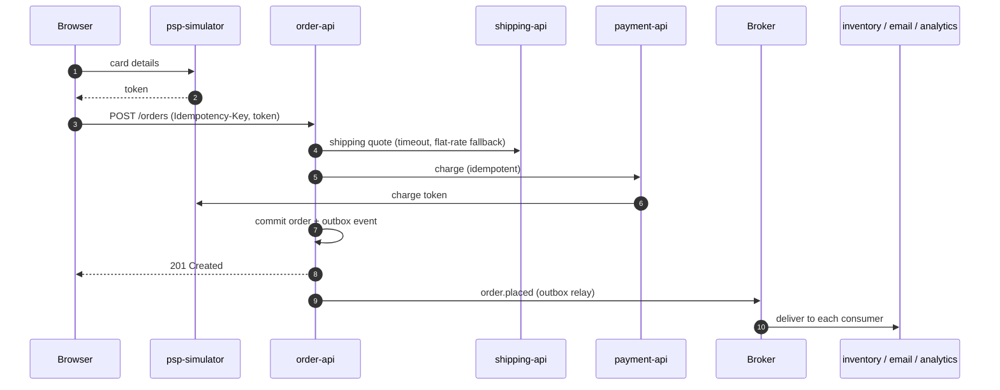

# LabFlow

An event-driven order-processing system: a small shop with checkout, payments, shipping quotes, refunds, stock, email and analytics. Services in Go and Python exchange events through one message broker per deployment, chosen with `BROKER=rabbitmq|kafka|sqs`.

LabFlow is the application half of a public Platform Engineering and SRE learning lab. Its job is to produce realistic traffic, data and failures for the platform in [labflow-platform](https://github.com/thiagogenez/labflow-platform), where the plan, design decisions and runbooks live. It serves no real customers. The payment provider and the mail server are simulations.

## Status

Implementation starts on 2026-11-19. This table is the source of truth for what exists.

| Capability | Status |
| --- | --- |
| Quality gate (pre-commit hooks, commit-message checks, CI) | Running in CI |
| Contribution workflow (pull request template, ticket references, pull request check) | Configured, CI pending first run |
| Services and Docker Compose environment | Planned |
| Message broker adapters (RabbitMQ, Kafka, SNS + SQS) | Planned |
| Signed multi-arch images on GHCR | Planned |

## Services

Planned services:

| Service | Language | Role |
| --- | --- | --- |
| `storefront` | Static HTML and JavaScript | Shop UI without login: catalog, cart, checkout, order status, refunds |
| `order-api` | Go | Catalog, server-side cart, checkout, orders and refund requests; transactional outbox |
| `payment-api` | Go | Charges and refunds through the payment provider; receives its signed webhooks |
| `shipping-api` | Python | Shipping quotes by weight, destination zone and speed |
| `inventory` | Go | Stock reads; applies order and refund events |
| `email-worker` | Python | Order confirmation, backorder and refund emails |
| `analytics-worker` | Python | Revenue per minute and top products, net of refunds |
| `psp-simulator` | Go | Simulated external payment provider, treated as a black box |

## Order Flow

Target design, not yet implemented:

## License

[MIT](LICENSE)
