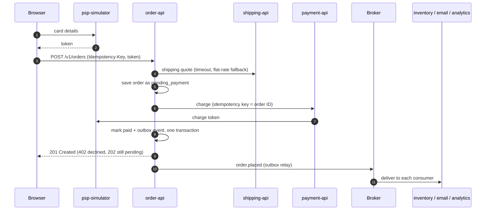

# LabFlow

[](https://github.com/thiagogenez/labflow/actions/workflows/ci.yml)
[](LICENSE)

An event-driven order-processing system: a small shop with checkout, payments, shipping quotes, refunds, stock, email and analytics. Services in Go and Python exchange events through one message broker per deployment, chosen with `BROKER=rabbitmq|kafka|sqs`.

LabFlow is the application half of a public Platform Engineering and SRE learning lab. Its job is to produce realistic traffic, data and failures for the platform in [labflow-platform](https://github.com/thiagogenez/labflow-platform), where the plan, design decisions and runbooks live. It serves no real customers. The payment provider, the supplier and the mail server are simulations.

## Status

Implementation starts on 2026-11-20. This table is the source of truth for what exists.

| Capability | Status |
| --- | --- |
| Quality gate (pre-commit hooks, commit-message checks, CI) | Running in CI |
| Contribution workflow (pull request template, ticket references, pull request check) | Running in CI |
| Event contracts (CloudEvents JSON Schema) | `order.placed` validated by the hooks and by order-api's producer tests; the others land with their producers |
| Payments: `psp-simulator` and `payment-api` in Docker Compose | Compose tested locally; Go tests in CI |
| Checkout: `order-api` (catalogue, quotes, orders, outbox) in Docker Compose | Compose tested locally; Go tests in CI; the outbox relay lands with RabbitMQ, and the payment reconciler with `shipping-api` |
| Other services (stock, shipping, email, analytics, storefront) | Planned |
| Message broker adapters (RabbitMQ, Kafka, SNS + SQS) | Planned |
| Signed multi-arch images on GHCR | Planned |

## Services


| Service | Language | Role |
| --- | --- | --- |
| `storefront` | Static HTML and JavaScript | Shop UI without login: catalog, cart, checkout, order status, refunds |
| `order-api` | Go | Catalog, server-side cart, checkout, orders and refund requests; transactional outbox |
| `payment-api` | Go | Charges orders through the payment provider and settles charges whose outcome is still unknown; refunds and the provider's signed webhooks come later |
| `shipping-api` | Python | Shipping quotes by weight, destination zone and speed |
| `inventory` | Go | Stock allocation and backorders; goods receipts and automatic replenishment |
| `email-worker` | Python | Order confirmation, backorder and refund emails |
| `analytics-worker` | Python | Revenue per minute and top products, net of VAT and refunds |
| `psp-simulator` | Go | Simulated external card payment provider, treated as a black box: card tokens, charges and test cards |
| `supplier-simulator` | Go | Simulated external supplier: accepts purchase orders and delivers stock after a lead time |

## Order Flow

Target design, not yet implemented:



A reconciler in order-api reads the charge's current state from payment-api, which keeps it up to date, and resubmits the charge only when payment-api has no record of it. After 15 minutes unresolved, order-api asks payment-api to cancel the charge and follows its answer: a charge that already succeeded takes the paid path, a recorded cancellation fails the order, and an unanswered cancellation stays under reconciliation. An order that answered 202 and then fails emits `order.payment_failed`, so the customer is emailed, and payment-api refunds any charge that succeeds after its cancellation.

## Events

Events are [CloudEvents](https://cloudevents.io/) whose JSON Schema contracts live in [`contracts/events/`](contracts/events/). On Kafka, each producer writes to its own topic (`orders`, `payments`, `inventory`) keyed by order ID; on RabbitMQ, the routing key is the event type. Delivery is at least once and unordered, so every consumer is idempotent and tolerates reordering.

| Event type | Producer | Consumers |
| --- | --- | --- |
| `labflow.order.placed.v1` | `order-api` | `inventory`, `email-worker`, `analytics-worker` |
| `labflow.order.payment_failed.v1` | `order-api` | `email-worker` |
| `labflow.refund.requested.v1` | `order-api` | `payment-api` |
| `labflow.payment.refunded.v1` | `payment-api` | `order-api` |
| `labflow.payment.refund_failed.v1` | `payment-api` | `order-api` |
| `labflow.refund.completed.v1` | `order-api` | `inventory`, `email-worker`, `analytics-worker` |
| `labflow.refund.failed.v1` | `order-api` | `email-worker` |
| `labflow.payment.late_charge_refunded.v1` | `payment-api` | `order-api`, `email-worker` |
| `labflow.inventory.allocated.v1` | `inventory` | `order-api`, `email-worker` |
| `labflow.inventory.backorder_allocated.v1` | `inventory` | `order-api`, `email-worker` |

## Run Locally

Needs Docker. Run `make setup` once, then start everything:

```sh
docker compose up --build --wait
```

| Address | Service |
| --- | --- |
| <http://localhost:8082> | `order-api`, the shop's public API |
| <http://localhost:8081> | `payment-api` |
| <http://localhost:8090> | `psp-simulator`, the simulated payment provider |
| <http://localhost:16686> | Jaeger, the trace viewer |

Order with a test card: list the products, ask for a quote, then pay exactly the total the quote showed.

```sh
curl -s localhost:8082/v1/products | jq -c '.products[] | {sku, name, unit_price_gross}'
lines='[{"sku":"PIP-ADJ-100","quantity":1},{"sku":"BOOK-LABTECH","quantity":1}]'
total=$(curl -s localhost:8082/v1/quotes -H 'Content-Type: application/json' \
  -d "{\"shipping_country\":\"DE\",\"shipping_speed\":\"standard\",\"lines\":$lines}" | jq .totals.gross_amount)
publishable_key=pk_test_local # the local test key set in compose.yaml
card=$(docker compose exec -T psp-simulator /service cards --brand visa --outcome approve)
token=$(curl -s localhost:8090/v1/tokens -H "Authorization: Bearer $publishable_key" \
  -H 'Content-Type: application/json' -d "$card" | jq -r .id)
curl -s localhost:8082/v1/orders -H "Idempotency-Key: \"$(uuidgen)\"" -H 'Content-Type: application/json' -d @- <<JSON
{"customer": {"email": "ada@example.com", "first_name": "Ada", "last_name": "Lovelace"},
 "shipping_address": {"line1": "Musterstraße 1", "line2": "", "postal_code": "10115", "city": "Berlin", "country": "DE"},
 "shipping_speed": "standard", "lines": $lines, "payment_token": "$token", "expected_total": $total}
JSON
```

The answer carries the order and its `access_token`; `GET /v1/orders/{order_id}` with `Authorization: Bearer <access_token>` reads it back. A total that no longer matches the quote gets 409 `price_changed` with the new quote, and nothing is charged.

The test cards are fictitious and work only against `psp-simulator`, which validates them like a real provider (check digit, brand, expiry, security code). `--brand` is `visa`, `mastercard` or `amex`; `--outcome` chooses what happens:

| Outcome | psp-simulator | order-api answers |
| --- | --- | --- |
| `approve` | charges at once | 201, paid; `order.placed` is written to the outbox |
| `decline` | refuses: insufficient funds | 402, with the order |
| `slow` | charges after 10 seconds | 202, pending |
| `pending` | pending, approved after 30 seconds | 202, pending |
| `pending_decline` | pending, refused after 30 seconds | 202, pending |

A 202 order is not yet reconciled automatically: it stays `pending_payment`, without `order.placed`, even after payment-api settles its charge, until the client retries the same checkout after its stored answer expires, or the payment reconciler arrives. `orders_pending_payment` on `/metrics` counts such orders.

`make test` runs every Go module's tests against real PostgreSQL in throwaway containers.

## Production Gaps

LabFlow is designed to production standards; only its data and its external systems are simulated. A real shop would also need the following, which the lab deliberately leaves out:

- VAT through the One-Stop Shop, and invoices. Charging German VAT (19 % or 7 %) on every EU sale is valid only while EU distance sales stay at or below EUR 10,000 in both the current and the previous calendar year.
- Erasure and retention of personal data under the GDPR.
- Fulfilment (picking, shipping, tracking) and returns logistics. Refunds assume the goods come back resellable.
- An authenticated back office for the catalogue, prices and stock.
- Customer accounts, 3-D Secure and chargebacks.

## License

[MIT](LICENSE)
