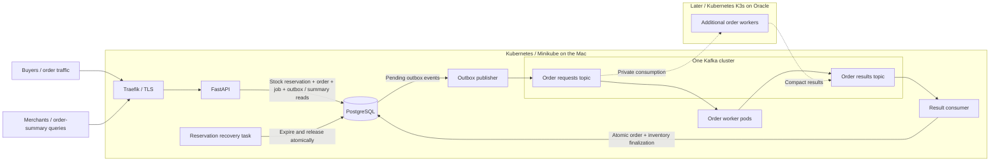

# LabFlow Implementation Plan

Status: M0 and the M1 calculation foundation are complete, including successful PR and main CI runs for the shared quality gate. M2-M5 have not started. Updated 2026-11-09: confirmed scope includes finite-stock reservation at buyer admission, asynchronous orders through the API/events and merchant summaries by period, showing confirmed and pending amounts separately plus their combined total; payments are deferred. The [agreed application contract](application-contract.md) replaces the seed-driven report-request model.

## Purpose and Working Agreement

Build a reproducible learning lab, demonstrate behavior, and explain the evidence. Implement only the current agreed milestone. Each step includes its purpose, proposed change, implementation, experiment, expected/observed comparison, limitations, and a short comprehension check. Wait before advancing. Give the learner one command at a time when manual execution is necessary.

Keep code, README, runbooks, and reports in English; use Portuguese for teaching. Work only in this new repository and use no employer code, data, or configuration. Do not create accounts, paid resources, or public endpoints without specific authorization. Never request credentials in chat.

The initial twenty-hour allocation is a planning estimate. At that checkpoint, list completed and pending criteria with evidence, blockers, and next actions. Do not omit learning steps or declare the first demonstration complete while either mandatory experiment is pending.

## Confirmed Architecture

The Mac hosts the application core: FastAPI, Kafka, PostgreSQL, local order workers, the outbox publisher, the result consumer, reservation recovery task, Traefik, and observability. Argo CD enters after the initial local demonstration. Oracle later hosts K3s, additional order workers, and their instrumentation, connected through Tailscale.

Buyers submit orders; merchants query confirmed/pending order values from existing orders. Order processing is asynchronous. The initial bounded order-value summary is a database read through the API, not a request to generate sales or a second worker pipeline. API interfaces and recognition rules are defined in the application contract.



The Kafka topics belong to the same cluster. Local and remote workers share a worker consumer group; result persistence uses its own group. Remote workers have no PostgreSQL access.

Start with one Minikube node, one Kafka broker/controller in KRaft mode, one PostgreSQL instance, and one worker. This has no physical high availability. Local nodes share the same Mac; adding nodes does not create independent failure domains. Validate the provisioner before any multinode profile: the default host-path provisioner has a documented multinode limitation. [Minikube storage caveat](https://minikube.sigs.k8s.io/docs/tutorials/multi_node/)

FastAPI's documented API is the initial user interface; Grafana is the operational interface. A custom frontend is outside the first delivery.

## Data and Processing Contract

- Buyers submit store/product identifiers and quantities. The API atomically reserves all items and freezes trusted catalog prices and a versioned, bounded order snapshot. Workers validate/process that snapshot and return compact outcomes. Seeds belong to the API load generator, not public order or revenue inputs; workers no longer generate purchases.
- Merchant summaries select an authorized store and an offset-aware time interval. Return confirmed final amounts, pending frozen quotes, their combined total, status counts and currency. The agreed filter uses acceptance time in `[from, to)`. A successful order moves value between buckets without increasing the combined total; rejected and technically failed amounts are excluded. Payments are deferred; see the application contract.
- Limit total computation, concurrent work, pending jobs, execution duration, and event/result sizes. Protect resources on both admission and execution paths.
- Use a job identifier, scoped idempotency key, canonical input fingerprint, event identifier, and attempt identifier. A repeated key with the same input returns the existing job; different input is a conflict.
- Public order transitions are `pending -> confirmed | rejected | processing_failed`; business rejection differs from technical failure. Pending orders hold reservations. Internal jobs and attempts must preserve these distinct outcomes. Terminal states do not regress. Attempt records carry execution details; stale attempts cannot overwrite a newer resolution.
- Reserve all inventory items and accept the order, its processing job and its outbox event in one PostgreSQL transaction. A database commit followed by a separate Kafka publish would otherwise leave a failure window with a durable order but no event.
- The outbox publisher marks an event sent only after Kafka acknowledgement. A crash between acknowledgement and marking can republish the event.
- Workers publish an outcome durably before committing input offsets. The result consumer commits its PostgreSQL transaction before committing result offsets. Never advance a partition offset past unfinished messages.
- Deduplicate events and final effects transactionally, using database constraints and attempt/state checks. Repeated computation is allowed; duplicate authoritative results are not. Do not claim system-wide exactly-once processing.
- Track retry counts and scheduling durably, with bounded logical attempts, backoff and jitter; redelivery can re-execute the same logical attempt. The result consumer can schedule the next attempt through an outbox entry in the same transaction as the attempt resolution. Permanent or exhausted processing failures become terminal; malformed events require quarantine and an explicit replay procedure.
- Confirmation consumes the reservation; rejection or definitive failure releases it, atomically with guarded terminal state. Durable deadlines and a core recovery task resolve expired reservations; late results cannot confirm after release. Inventory stays in PostgreSQL, unavailable to workers. Replenishment endpoints and payments are later extensions.
- A transport outage leaves publication or consumption pending. It does not authorize acknowledging an unpersisted result. Define handling for repeatedly crashing or stuck attempts before claiming bounded recovery.

Tests must cover concurrent reservation of the last units, multi-item rollback, reservation release/expiry and late-result races, repeated order submissions, conflicting idempotency keys, stable accepted prices, concurrent duplicate results, stale attempt events, bounded retries, and crashes around outbox publication, worker acknowledgement, and result persistence. Merchant-summary tests cover store authorization, time boundaries, confirmed/pending bucket transitions, failed-amount exclusion and unchanged amounts/counts after duplicate delivery. The most dangerous windows must be reproduced against real PostgreSQL and Kafka. [Kafka delivery semantics](https://github.com/apache/kafka/blob/trunk/docs/design/design.md)

## Resource Ownership and Kustomize Learning

The generator, unit tests, and CI paths exist. Deployment, infrastructure, and experiment paths below will be created in their milestones:

```text
src/labflow/                 API, generator, relay, workers, result persistence
tests/                      unit and integration tests
deploy/base/                shared application resources
deploy/overlays/local/      fixed-replica baseline profile
deploy/overlays/autoscaling/ CPU-HPA experiment profile
infra/helm/                 pinned infrastructure charts and explicit values
.github/workflows/          CI from the first implementation
experiments/                protocols, evidence, and reports
```

| Resources or fields | Initial owner | Later transition |
| --- | --- | --- |
| Cluster, CNI, provisioner, infrastructure namespaces | Documented Minikube/bootstrap configuration | Change only in a dedicated platform step |
| Kafka, PostgreSQL, Traefik, observability, Metrics Server when chart-managed | Helm releases with pinned charts and explicit values | Explicit transfer before Argo manages chart-rendered objects |
| Application Deployments, Services, ConfigMaps, Ingress, application policies and quotas | Kustomize base plus one selected overlay | Argo reconciles the selected overlay |
| Worker replica count in the autoscaling profile | One CPU-based HPA | No competing HPA, KEDA policy, or GitOps replica reconciler |
| Initial credentials | Local secret generation and documented manual application | Encrypted GitOps secrets only after recovery is tested |

Choose a single installation owner for addons such as Metrics Server; never enable an addon and install a chart for the same resources. Record namespace and shared-resource ownership when creating them.

The base contains common application definitions and does not know about overlays. Both overlays must reference that base and demonstrate meaningful configuration and CPU/memory changes without copying complete Deployments. The autoscaling overlay adds the HPA and leaves worker replicas under its control. The profiles are alternatives for the same lab, not two concurrent installations. [Kustomize bases and overlays](https://kubernetes.io/docs/tasks/manage-kubernetes-objects/kustomization/)

Learning proof: render both overlays, explain their differences, identify each resulting resource's owner, and demonstrate the selected profile. Review changes to workload limits when comparing performance so resource differences are not mistaken for an autoscaling effect.

When Argo CD is introduced, document bootstrap and ownership transfer. Argo rendering a Helm chart is different from Helm managing a release; do not leave two managers operating the same resources. [Argo CD and Helm](https://argo-cd.readthedocs.io/en/stable/user-guide/helm/)

## Milestones and Completion Gates

All time allocations below are estimates, not elapsed time or delivery promises.

| Milestone | Allocation | Completion evidence |
| --- | ---: | --- |
| M0: plan and preflight | 2 h | Approved scope recorded; essential host/storage and first-code tool checks completed; component-specific runtime/capacity checks assigned to their execution stages |
| M1: first Python slice and basic CI | 2 h | Bounded deterministic generator; documented lint/tests; verified GitHub Actions checks on a PR and the resulting main commit |
| M2: orders, inventory and summaries | Original 5 h estimate; reassess | Order API/state/price snapshots, atomic inventory reservation/resolution and expiry, outbox, real PostgreSQL/Kafka integration, worker/result persistence, authorized order-summary queries and failure-window tests |
| M3: local Kubernetes operation | 4 h | ARM64 execution, Helm infrastructure, both Kustomize overlays rendered and compared, persistent data, probes, resources and network isolation verified |
| M4: baseline and duplicate-delivery experiment | 3 h | Useful dashboards, initial actionable private/local alert, baseline and duplicate-delivery evidence, result correctness checked |
| M5: operational CPU autoscaling | 3 h | Controlled traffic increase produces observed HPA scale-out and available workers; CPU, lag and completion behavior compared and explained |
| Contingency | 1 h | Resolve failures or record remaining work accurately |
| Total review budget | 20 h | Review every gate; extend the schedule if required |

The M2 estimate predates the two-actor and reservation contract and is not a new delivery commitment. Implement order calculations first, API/database order admission and summary reads second, and the event pipeline third. Reassess the remaining work after the first slice; retain both operational experiment gates.

Current progress: M0 and the M1 reporting foundation are complete. The bounded `sales-v1` generator and report aggregation have 26 passing pytest cases across 14 functions. The shared quality gate passed [PR CI](https://github.com/thiagogenez/labflow/actions/runs/42521136229) and [main CI](https://github.com/thiagogenez/labflow/actions/runs/42521372612) at `2ff07d8`, including native Linux ARM64 execution, ShellCheck, Python quality checks, Gitleaks and dependency auditing. These runs cover the reporting foundation and shared quality gate; later changes require their own validation. M2-M5 have not started. Exact stack consumption will be measured during component execution.

If twenty hours are exhausted, publish the exact pending criteria, such as missing HPA observations or an unresolved integration test, with a next step. Keep the demonstration marked incomplete until both experiments and their explanations satisfy the criteria.

### CI Starts with the First Implementation

The first Python change includes dependency/tool version choices, local lint/test commands, and a GitHub Actions workflow triggered by pull requests and pushes to `main`. M1 uses Ruff default lint rules, Black default stable formatting, Pylint default diagnostics, and pytest. LabFlow is installed in the project Python 3.14 environment; pytest fixtures will support later integration setup. Gitleaks and OSV-Scanner definitions cover secrets and pinned Python dependencies; their actual execution remains a completion gate. Add real service integration tests as PostgreSQL and Kafka code appears, ARM64 image build/execution and image vulnerability checks when images appear, and Helm/Kustomize rendering and schema validation with their manifests.

Use least-privilege permissions per job, verified full-SHA action references, pinned dependencies, bounded execution times, isolated test data, cleanup, and concurrency control. Untrusted PR code receives no publishing credentials; authenticated publishing is a later workflow. A workflow file alone is not evidence of a successful CI run. [GitHub Actions security guidance](https://docs.github.com/en/actions/reference/security/secure-use)

### Kubernetes and Observability Gates

Provide suitable startup, readiness, and liveness probes; requests/limits; namespaces; ResourceQuota; LimitRange; persistent storage; least-privilege ServiceAccounts/RBAC; and enforced NetworkPolicies. Avoid unnecessary API tokens in application pods. Prove both allowed and denied network paths with a capable CNI; Calico is the candidate, pending compatibility validation. Check how persistent volumes behave on pod replacement and under capacity pressure.

Traefik implements Ingress HTTP routing and TLS; Services identify application backends. Broker, database, and administrative interfaces remain local or private. Initial secrets are generated outside Git with separate responsibilities and fictitious examples. Verify encryption at rest; base64 encoding alone provides no confidentiality.

Measure HTTP requests/errors/latency by operation; orders and processing jobs accepted/completed/failed; pending age, queue wait and total completion time; processing duration/throughput; retries/duplicates; consumer lag; CPU, memory, throttling, OOM and restarts; desired/available/pending replicas; and broker/database health. Track summary-query latency and pending-order count/value separately; the combined amount does not establish processing health. Use structured correlation logs and bounded metric labels; never use order/job/buyer IDs as metric labels.

Application code and exporters produce metrics; Prometheus collects and evaluates rules; Grafana queries; Alertmanager groups, silences, and routes actionable alerts to a local/private receiver. Select SLO targets and windows after the baseline. Include accepted jobs that remain pending in completion SLIs; a short test is not monthly availability history.

## Mandatory Experiment A: Duplicate Delivery

Hypothesis: a result-consumer crash after PostgreSQL commit but before Kafka offset commit causes re-delivery while preserving one authoritative result per order and unchanged merchant order values and inventory.

1. Calibrate bounded order traffic; record the request-generator seed/version, catalog version, basket sizes, input trace, images, resources and Kafka configuration.
2. Proposed initial run: 100 unique valid orders over 60 seconds with sufficient finite initial stock, plus 10 API re-submissions with their original idempotency keys. Fix a drain timeout after calibration; it is an experiment limit, not an SLO.
3. Capture a baseline, then reproduce the same workload with a one-shot failure point at the specified commit boundary.
4. Restart the consumer and prove re-delivery through event/attempt correlation and offset evidence. Confirm 100 unique orders and processing jobs, one final result per order, exactly one inventory consumption per confirmed order, no retained terminal reservations, correct totals from accepted price snapshots, correct pending-to-confirmed movements, and no duplicate contribution to any merchant-summary amount or count.
5. Compare completion time, throughput, lag, retries, duplicate suppression, and resources. Explain recovery and the preventive role of the transaction and constraints.

Pass requires actual failure/re-delivery evidence, database, inventory and summary correctness checks, and all 100 valid orders completing successfully within the declared drain window. HTTP idempotency alone does not prove consumer deduplication. Unexpected failures or timeouts fail this run and must be reported, not removed from the dataset.

## Mandatory Experiment B: CPU Autoscaling

Hypothesis: with CPU-bound workers, spare cluster capacity, and enough Kafka partitions, sustained additional job traffic increases worker CPU and backlog and causes the HPA to add workers. Any throughput or latency improvement remains a measurement, not a promise.

The workload now processes bounded order snapshots. First establish whether it becomes CPU-limited under safe buyer traffic. Keep merchant-query load fixed during the HPA comparison, then study it separately as database pressure. Do not assume simple order arithmetic is expensive or introduce busy loops to force scale-out; if prerequisites are not met, record this gate as pending and investigate the measured bottleneck.

1. Verify Metrics Server, CPU requests, sufficient Kafka partitions, available CPU/memory, quotas, and application cost limits. Initially propose a one-to-two worker range, subject to preflight and calibration.
2. Use a low arrival rate to establish CPU, lag, and job-completion measurements. Choose the HPA target and observation windows from calibration; record them before the comparison.
3. Increase buyer order submissions while holding the basket-size distribution, processing rules and merchant-query traffic fixed. First measure a fixed-worker control with HPA disabled and the same worker configuration used by the autoscaling profile; then repeat the same load phases with HPA enabled. Record the effective manifests and keep per-worker resources identical between these runs. Record initial/remaining/reserved inventory; ensure sufficient stock for the accepted-load target. Start each comparison from a drained queue and reset/isolate business data so earlier orders cannot distort summary checks.
4. Record HPA conditions/current/target CPU, desired and available replicas, pod readiness/scheduling, partition assignments, backlog, throughput, completion latency, throttling, memory, and restarts.
5. Prove the scale-out occurred and the additional worker received work. Reduce traffic, observe stabilization/recovery, and explain the measured comparison and any limits or competing bottlenecks.

CPU HPA reads resource metrics through Metrics Server, not directly from Prometheus. Omit a competing desired worker replica value from the autoscaling manifests. HPA does not create physical capacity, and partition assignment is different from HTTP balancing. [HPA operation and replica ownership](https://kubernetes.io/docs/concepts/workloads/autoscaling/horizontal-pod-autoscale/)

Pass requires actual scale-out plus analysis of CPU, backlog, and completion behavior. A manifest, unavailable metrics, or desired replicas with permanently pending pods does not complete this experiment. Linear speedup is not required. Retry the bounded experiment after explaining and fixing a failed prerequisite.

## Experiment Evidence Format

Every report records hypothesis and configuration; load, duration and versions; before/after metrics; induced failure or load transition and evidence; diagnosis, recovery and preventive action; expected versus observed behavior; and limits of the conclusion. Include reproduction and cleanup instructions when executable steps exist. Screenshots supplement machine-readable evidence. Record unanswered questions and the learner's explanation without inventing responses.

## Later Milestones

- GitOps delivery: test the resulting main commit, publish a traceable image to GHCR, promote its digest through an explicit PR, reconcile with Argo CD, and verify with smoke tests/metrics. Promote the same artifact. Roll back through Git to the previous digest with compatible migrations; application rollback is not data recovery.
- Local operational extensions: HTTP distribution, slow workers/backlog, broker versus worker/database bottlenecks, defective releases, CPU/memory pressure, noisy neighbors, and node maintenance. Gateway API and lag-based scaling are later; use one scaling controller per workload.
- Oracle: validate quota, region, availability and free-resource terms; establish Tailscale connectivity; verify every advertised Kafka broker endpoint, DNS, TLS and permissions from remote consumers; activate workers manually. No automatic VM creation or custom cross-cluster scaler. K3s contains workers and instrumentation, not a duplicate platform.
- Recovery before replicated profiles: encrypted off-Mac backups of data and secret-recovery material; rebuild from the repository; restore a minimal Oracle core and measure RPO/RTO. Fence the old core before accepting writes, check missing/pending/duplicate jobs, and document safe failback. Validate PostgreSQL/Kafka consistency explicitly; reconstruction and replay from retained, versioned job inputs is a candidate, not a tested guarantee. Automatic failover is excluded.
- Encrypted secrets: evaluate SOPS with age and its Argo integration only after backing up private recovery material outside the Mac and proving decryption/recreation in a clean environment. Exercise rotation and pod updates. Secrets must never enter logs, metrics, or CI artifacts.
- Application Redis: measure without cache first; add bounded cache-aside storage for completed results with TTL and database fallback. Compare hits/misses, database queries, outage behavior, popular-key expiration and memory pressure. Argo's internal Redis is a separate operational dependency.
- Advanced consistency: replicated profiles with explicit quorum and partition settings for CAP experiments. A disconnected worker alone is not a CAP demonstration.

All later milestones retain their own preflight, resource budget, evidence, and learning pause. Their requirements are not silently absorbed into the first twenty hours.
