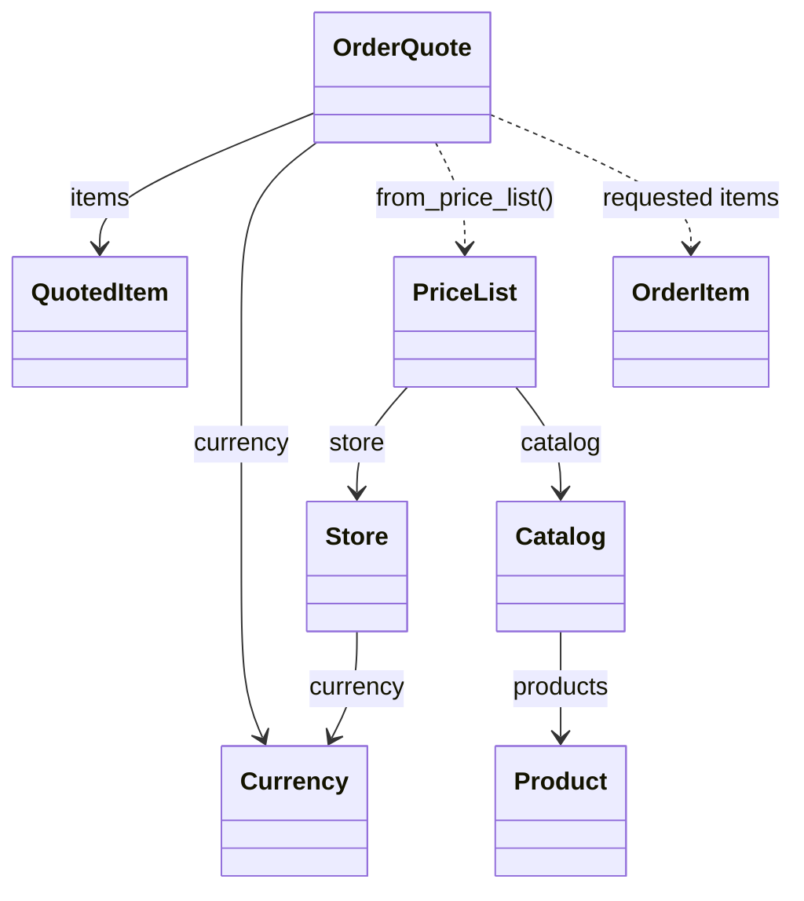

# LabFlow Application Model

Immutable store configuration, shared product metadata and price quotations are implemented and tested locally. Their remote CI is pending. Inventory, order acceptance, asynchronous processing and persistence remain planned; see the [application contract](../../docs/application-contract.md).


*Three-step walkthrough of object relationships. Highlights select the relationship being explained; they do not represent execution, messages or traffic. Solid arrows point to retained references. Dashed arrows point to constructor inputs whose values are copied. [Static alternative](../../docs/assets/labflow-domain.png).*

## Reading the Animation

1. Both `PriceList` objects point to the same `Catalog`: each stores that reference.
2. Each list references its own `Store` (shown as a label), derives its currency and stores its own SKU prices. Catalog metadata is shared; store prices are independent.
3. `OrderQuote.from_price_list` reads a list and requested `OrderItem` values, then creates `QuotedItem` snapshots. A quote keeps the copied values, not a reference to the price list. The dashed arrow shows this construction dependency.

An arrow means **the object at its tail uses the object at its tip**. It is not a network connection or a message route. The values shown are the same in every frame; animation only changes the explanatory highlight. The footer describes the current step. Row colors identify the two stores, not processing states.

## Class Relationships



Solid arrows represent retained object references. Dashed arrows represent construction dependencies: a quote copies values without retaining the request objects or the price list itself.

| Model | Responsibility |
| --- | --- |
| [Product](catalog.py) | Immutable SKU, name and description |
| [Catalog](catalog.py) | Versioned product metadata shared across stores; no prices or stock |
| [Store](store.py) | Store identity and its fixed [Currency](currency.py), EUR or BRL |
| [PriceList](price_list.py) | One store's versioned prices for a subset of products in a shared catalog |
| [OrderItem](orders.py) | Requested SKU and quantity |
| [QuotedItem](orders.py) | Requested quantity with a copied unit price |
| [OrderQuote](orders.py) | Store, currency, both snapshot versions and immutable quoted items |

A `PriceList` is a table containing prices for multiple products. Our object is an immutable snapshot of that table, not a purchase order or a snapshot of one product. Catalog membership does not guarantee that a store offers a product or has stock available.

## One Catalog, Two Stores

```python
from labflow.catalog import Catalog, Product
from labflow.currency import Currency
from labflow.orders import OrderItem, OrderQuote
from labflow.price_list import PriceList
from labflow.store import Store

catalog = Catalog("products-v1", {"sku-shirt": Product("sku-shirt", "Black T-shirt, M")})
berlin = Store("store-berlin", Currency.EUR)
saopaulo = Store("store-saopaulo", Currency.BRL)
berlin_prices = PriceList(berlin, "prices-v1", {"sku-shirt": 1990}, catalog)
saopaulo_prices = PriceList(saopaulo, "prices-v1", {"sku-shirt": 5990}, catalog)
items = (OrderItem("sku-shirt", 2),)

for prices in (berlin_prices, saopaulo_prices):
    quote = OrderQuote.from_price_list(items=items, price_list=prices)
    print(quote.store_id, quote.currency.value, quote.total_cents)
```

Expected output, with amounts in integer cents:

```text
store-berlin EUR 3980
store-saopaulo BRL 11980
```

Prices are independently configured; no exchange rate or currency conversion is involved. Catalog and price-list versions are descriptive identifiers; persistence must enforce their uniqueness and official ownership. These objects do not perform authorization or reserve inventory.

## Commerce Concepts, Not a Shopify Replica

Shopify also has price lists, but its [Catalog](https://shopify.dev/docs/api/admin-graphql/2026-01/queries/catalogs) controls product publishing and contextual pricing, while its [PriceList](https://shopify.dev/docs/api/admin-graphql/2026-01/objects/PriceList) has its own currency. LabFlow deliberately uses a smaller model: shared product metadata and one fixed currency per store. The class diagram describes our code, not Shopify's schema or an integration with it.

## Reproduce and Verify

Run from the repository root using the installed project environment:

```bash
.venv/bin/python .github/scripts/render_readme_assets.py --diagram domain
```

The [renderer](../../.github/scripts/render_readme_assets.py) produces the GIF and PNG together. Its default mode continues to render the separate worker-flow illustration in the root README. Run `.venv/bin/python -m pytest -v` for executable domain guarantees. Generated images were inspected locally; GitHub Mermaid rendering remains to be verified after publication.
