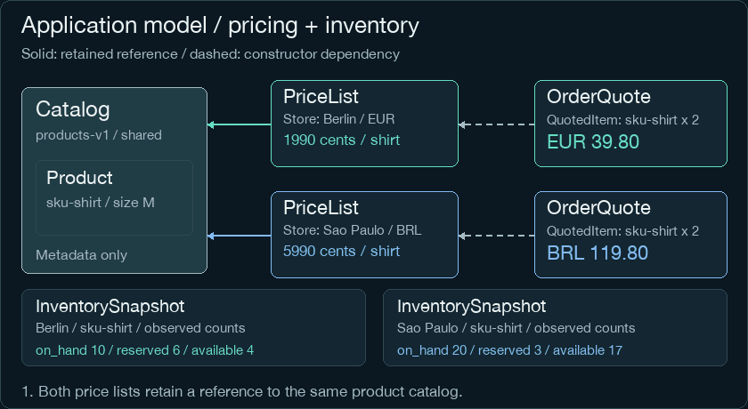
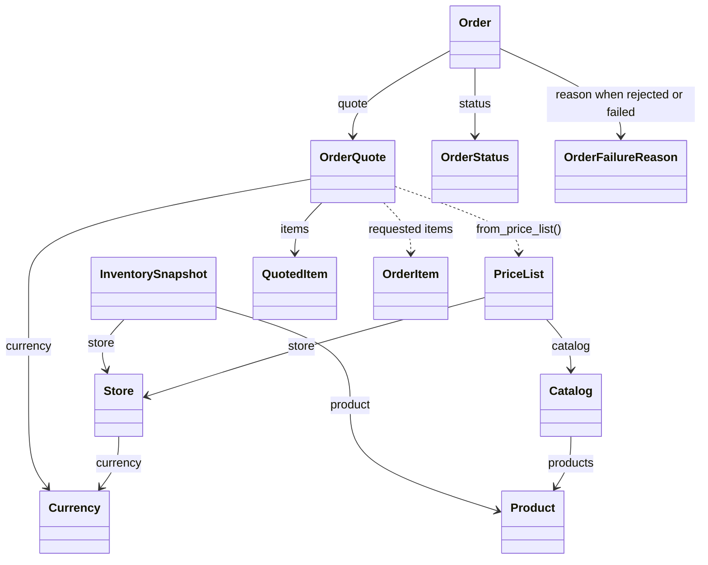
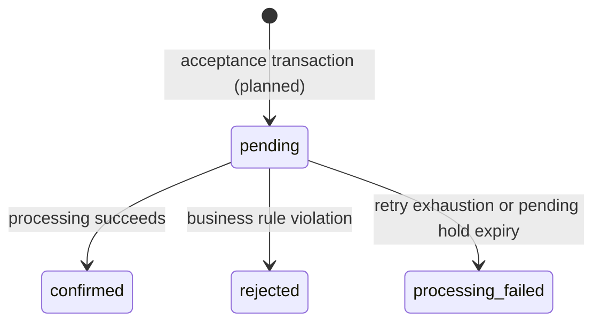

# LabFlow Application Model

Immutable store configuration, shared product metadata and price quotations are implemented. Immutable inventory snapshots and availability calculations are implemented. Accepted-order lifecycle rules are also tested locally with remote CI pending. Transactional inventory, durable order acceptance, asynchronous processing and persistence remain planned; see the [application contract](../../docs/application-contract.md).



*Four-step walkthrough of object relationships. Inventory boxes show illustrative observed counts, not stock updates. Highlights select the relationship being explained; they do not represent execution, messages or traffic. Solid arrows point to retained references. Dashed arrows point to constructor inputs whose values are copied. The processing lifecycle is shown separately in the state diagram below. [Static alternative](../../docs/assets/labflow-domain.png).*

## Reading the Animation

1. Both `PriceList` objects point to the same `Catalog`: each stores that reference.
2. Each list references its own `Store` (shown as a label), derives its currency and stores its own SKU prices. Catalog metadata is shared; store prices are independent.
3. `OrderQuote.from_price_list` reads a list and requested `OrderItem` values, then creates `QuotedItem` snapshots. A quote keeps the copied values, not a reference to the price list. The dashed arrow shows this construction dependency.
4. Each `InventorySnapshot` identifies a store and SKU and displays independent observed counts. Highlighting the boxes does not reserve or consume units; `available` is derived from `on_hand - reserved`.

An arrow means **the object at its tail uses the object at its tip**. It is not a network connection or a message route. The values shown are the same in every frame; animation only changes the explanatory highlight. The footer describes the current step. Row colors identify the two stores, not processing states.

## Class Relationships



Solid arrows represent retained object references. Dashed arrows represent construction dependencies: a quote copies values without retaining the request objects or the price list itself.

| Model | Responsibility |
| --- | --- |
| [Product](catalog.py) | Immutable SKU, name and description |
| [Catalog](catalog.py) | Versioned product metadata shared across stores; no prices or stock |
| [Store](store.py) | Store identity and its fixed [Currency](currency.py), EUR or BRL |
| [PriceList](price_list.py) | One store's versioned prices for a subset of products in a shared catalog |
| [InventorySnapshot](inventory.py) | Immutable on-hand and reserved counts for one store/SKU; derives available stock |
| [Order](orders.py) | Immutable accepted quote, identity, UTC timestamps and guarded processing decisions |
| [OrderStatus / OrderFailureReason](orders.py) | Processing states and safe business/technical reason codes |
| [OrderItem](orders.py) | Requested SKU and quantity |
| [QuotedItem](orders.py) | Requested quantity with a copied unit price |
| [OrderQuote](orders.py) | Store, currency, both snapshot versions and immutable quoted items |

A `PriceList` is a table containing prices for multiple products. Our object is an immutable snapshot of that table, not a purchase order or a snapshot of one product. Catalog membership does not guarantee that a store offers a product or has stock available.

## One Catalog, Two Stores

```python
from labflow.catalog import Catalog, Product
from labflow.currency import Currency
from labflow.orders import OrderItem, OrderQuote
from labflow.price_list import PriceList
from labflow.store import Store

catalog = Catalog("products-v1", {"sku-shirt": Product("sku-shirt", "Black T-shirt, M")})
berlin = Store("store-berlin", Currency.EUR)
saopaulo = Store("store-saopaulo", Currency.BRL)
berlin_prices = PriceList(berlin, "prices-v1", {"sku-shirt": 1990}, catalog)
saopaulo_prices = PriceList(saopaulo, "prices-v1", {"sku-shirt": 5990}, catalog)
items = (OrderItem("sku-shirt", 2),)

for prices in (berlin_prices, saopaulo_prices):
    quote = OrderQuote.from_price_list(items=items, price_list=prices)
    print(quote.store_id, quote.currency.value, quote.total_cents)
```

Expected output, with amounts in integer cents:

```text
store-berlin EUR 3980
store-saopaulo BRL 11980
```

Prices are independently configured; no exchange rate or currency conversion is involved. Catalog and price-list versions are descriptive identifiers; persistence must enforce their uniqueness and official ownership. These objects do not perform authorization or reserve inventory.

## Inventory Read Snapshots

Using `berlin` and `catalog` from the example above:

```python
from labflow.inventory import InventorySnapshot

snapshot = InventorySnapshot(
    berlin, catalog.products["sku-shirt"], on_hand=10, reserved=6
)
print(snapshot.on_hand, snapshot.reserved, snapshot.available)
```

Expected output: `10 6 4`. The supplied counts represent an observed balance; constructing the object does not reserve stock. `available = on_hand - reserved` is derived and the object rejects counts outside `0 <= reserved <= on_hand`.

Each snapshot identifies one store/SKU. Shared product metadata does not combine stock across stores. The animation highlights inventory read snapshots in step four; the class diagram shows their retained Store and Product references.

**Persistence decision:** stock changes will use conditional PostgreSQL updates inside transactions. The persistence layer will construct snapshots from returned rows. A snapshot may become stale and must not authorize a reservation or overwrite current database counts. There are no `reserve`, `release` or `consume` methods on this read model. Database constraints, order-linked reservations, idempotency and concurrent integration tests belong to the persistence milestone; no database is implemented in this slice.

## Accepted Order Lifecycle



These four states cover the current processing scope. Pending includes queued, running and retrying work; execution details belong to jobs and attempts. Payment and fulfillment will have independent lifecycles. Cancellation requires its own business rules before introduction. `OrderFailureReason` applies only to rejection or definitive processing failure; pending and confirmed orders have no reason. Confirmation keeps units reserved for fulfillment; it does not remove physical stock. Rejection/final technical failure will release the pending hold transactionally. Only a later shipment will remove physical units. Pending-order expiry must never release a confirmed commitment.

Using `berlin_prices` from the example above:

```python
from datetime import UTC, datetime
from uuid import UUID
from labflow.orders import Order, OrderStatus

pending = Order(
    order_id=UUID("00000000-0000-4000-8000-000000000001"),
    buyer_id="buyer-a",
    quote=OrderQuote.from_price_list(
        items=(OrderItem("sku-shirt", 2),), price_list=berlin_prices,
    ),
    accepted_at=datetime(2026, 11, 10, 10, tzinfo=UTC),
)
confirmed = pending.resolve(
    OrderStatus.CONFIRMED, at=datetime(2026, 11, 10, 10, 0, 2, tzinfo=UTC),
)
print(pending.status.value, confirmed.status.value, confirmed.quote.total_cents)
```

Expected output: `pending confirmed 3980`. The amount is EUR cents, not a payment receipt. The original pending object and accepted quote remain unchanged. For a different example outcome, resolve the pending object to `REJECTED` with `BUSINESS_RULE_VIOLATION`, or `PROCESSING_FAILED` with `RETRY_EXHAUSTED`. Reasons are safe codes; no new commercial rejection rule is implemented here.

`resolve` proposes a decision; it does not modify inventory, persist an order or deduplicate a message. Resolving a terminal snapshot again raises `InvalidOrderTransitionError`. A future core transaction must check current state, attempt and reservation deadline with database time and commit the decision and inventory effects atomically. The UUID maps naturally to an order key; buyer/store relationships, frozen line values, state/time constraints and unique idempotency/deduplication records belong to the persistence milestone. See the [full contract](../../docs/application-contract.md).

## Commerce Concepts, Not a Shopify Replica

Shopify also has price lists, but its [Catalog](https://shopify.dev/docs/api/admin-graphql/2026-01/queries/catalogs) controls product publishing and contextual pricing, while its [PriceList](https://shopify.dev/docs/api/admin-graphql/2026-01/objects/PriceList) has its own currency. LabFlow deliberately uses a smaller model: shared product metadata and one fixed currency per store. The class diagram describes our code, not Shopify's schema or an integration with it.

## Reproduce and Verify

Run from the repository root using the installed project environment:

```bash
.venv/bin/python .github/scripts/render_readme_assets.py --diagram domain
```

The [renderer](../../.github/scripts/render_readme_assets.py) produces the GIF and PNG together. Its default mode continues to render the separate worker-flow illustration in the root README. Run `.venv/bin/python -m pytest -v` for executable domain guarantees. Generated images were inspected locally; GitHub Mermaid rendering remains to be verified after publication.
